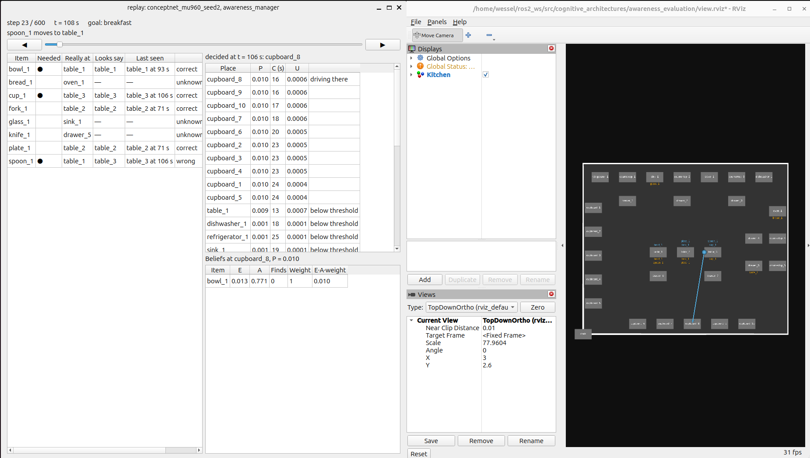
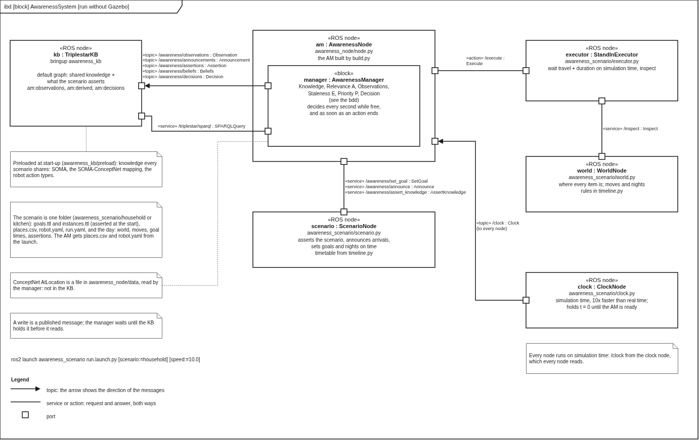
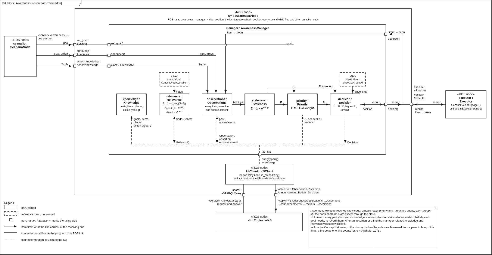
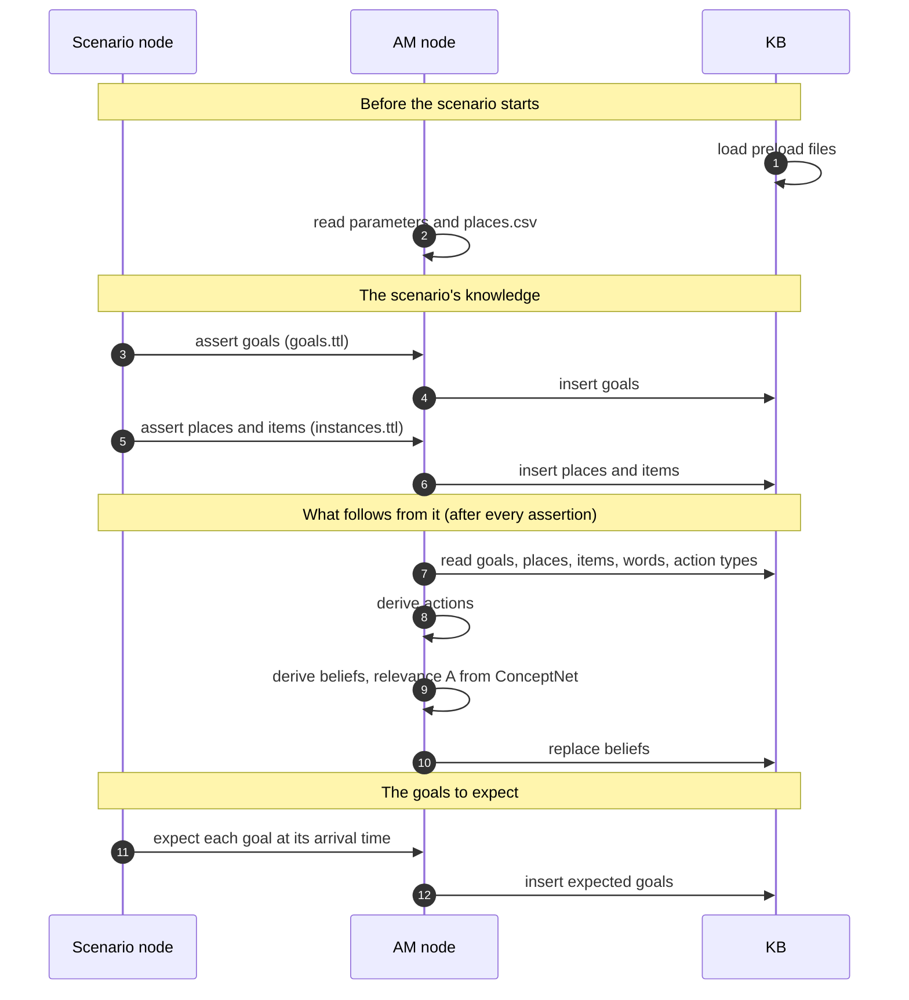
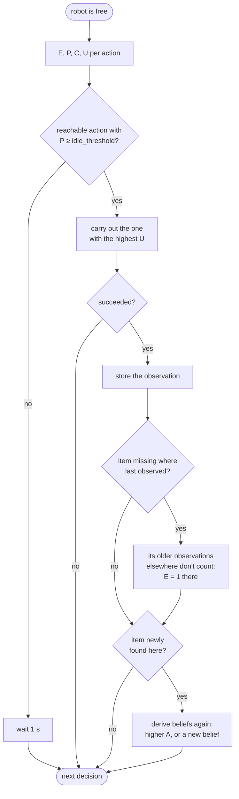

# cognitive_architectures

An awareness manager (AM) that decides what a household robot should observe next. MSc thesis, TU Delft.

Goals need items, and items move. A **belief** is that an item is at a place; an **action** observes every belief at one place.
The AM chooses the action with the highest utility:

| | General | Here |
|---|---|---|
| E | staleness: how outdated a belief's last observation is | 1 − e^(−Δt/μ), Δt since that observation; 1 if never observed |
| μ | persistence: the average time before an item moves | seconds, set per item |
| A | relevance: how strongly the evidence links the item to the place | ConceptNet's votes for the item at the place, and earlier finds there |
| goal weight | how much a goal counts now | 1 if active, less if expected later; summed over the goals that need the item |
| P = Σ E·A·goal weight | priority of an action | summed over the beliefs it observes |
| C | cost of an action | seconds to drive there and observe |
| U = P / C | utility of an action | priority per second |

At the start of the kitchen scenario, breakfast, coffee and dinner are expected and nothing is observed yet, so every E is 1.
ConceptNet relates plates (A = 0.77) and cups (A = 0.41) to tables. `table_1` has the highest P, 1.6, and at 32 s also the
highest U, so it is observed first. After that its E drops and `cupboard_1` follows.

## Layout

- `awareness_ros/`: the system
  - `awareness_node`: the AM
  - `awareness_kb`: the knowledge base (KB)
  - `awareness_msgs`: messages, services and actions
  - `awareness_scenario`: the scenarios, and the nodes that play them
  - `awareness_gazebo`: the robot (mirte) in Gazebo with Nav2
- `awareness_evaluation/`: the evaluation, without ROS nodes
- `workspace.repos`: pinned third-party sources

Earlier versions, as tags: `gazebo-proof-of-concept`, `old-testbed`.

## Setup

Ubuntu 24.04, ROS 2 Jazzy.

```bash
mkdir -p ~/ros2_ws/src && cd ~/ros2_ws/src
git clone git@github.com:Wesdebaas/cognitive_architectures.git
cd ~/ros2_ws
vcs import src < src/cognitive_architectures/workspace.repos

python3 -m venv --system-site-packages venv_cogarchs
source venv_cogarchs/bin/activate
pip install -r src/cognitive_architectures/requirements.txt

rosdep install -r --from-paths src -y --ignore-src --skip-keys \
  "python3-pyoxigraph-pip python3-reasonable-pip python3-oxrdflib-pip python3-opentelemetry-api-pip python3-opentelemetry-sdk-pip"
python3 -m colcon build --symlink-install
source install/setup.bash
```

`--skip-keys` skips the packages that `requirements.txt` installs in the venv, and `opentelemetry-sdk`, which
the KB needs only for tracing.

In every new terminal: `source ~/ros2_ws/venv_cogarchs/bin/activate` and `source ~/ros2_ws/install/setup.bash`.

## Run

From `src/cognitive_architectures`:

```bash
ros2 launch awareness_scenario run.launch.py scenario:=kitchen   # without Gazebo, 10x real time
ros2 launch awareness_gazebo run.launch.py                       # the same scenario in Gazebo
```

The AM prints each decision and what it observed. From the first command, log prefixes removed:

```
expected: breakfast at 90
expected: coffee at 240
expected: dinner at 330
at dock: inspect table_1  P = 1.623  C = 32  U = 0.0507
inspect table_1: cup_1; found, 1 beliefs changed
at table_1: inspect cupboard_1  P = 1.017  C = 34  U = 0.0299
```

Times and C are in seconds of simulation time. Gazebo shows only the robot and the house; the items are not drawn.

## Evaluation

Compares the AM with two round robins, which observe places in turn, in `kitchen_30`, a kitchen with 30 places.

```bash
ros2 run awareness_evaluation evaluate                           # 120 runs, about 3 minutes: prints a table, writes results.csv
ros2 run awareness_evaluation plot                               # correct.png and states.png, from results.csv
ros2 run awareness_evaluation score conceptnet_mu960_seed2       # one condition, per policy
ros2 run awareness_evaluation replay conceptnet_mu960_seed2      # step through the AM's run, with RViz
```

Run `evaluate` first; everything is written to `awareness_evaluation/runs/evaluation/`. A condition, such as
`conceptnet_mu960_seed2`, is a placement, a μ and a seed; each is run with every policy.

| | Values |
|---|---|
| placement | where items start and move to. `uniform`: every kind of place related to the item is equally likely; `conceptnet`: likelier with more ConceptNet votes |
| μ | 240, 480, 960 or 1920 s |
| seed | 1 to 5, for the random draws |
| policy | `awareness_manager`; `round_robin_item_places`: the places with beliefs; `round_robin_all_places`: all places |

Measure: while a goal is active, the share of time in which the observations place the items it needs where they really are
(`correct`), elsewhere (`wrong`) or nowhere (`unknown`: not yet observed, or missing where last observed), averaged over
those items. `all items`: `correct` for every item, the whole run.



The replay: the spoon has just moved to `table_1`, but the robot last observed it at `table_3`: `wrong`. Left: the items, and
why the robot chose `cupboard_8`. Right: where the items really are (orange, below a place) and where the observations place
them (blue, above), with the robot and its way to the chosen place.

## Architecture



The ROS nodes of the run without Gazebo. The executor carries out the AM's actions; in Gazebo another executor drives the robot.



The parts of the AM, and what they exchange with each other and the KB.

### Start-up



<details>
<summary>The steps and their code</summary>

| Step | What happens | Where |
|---|---|---|
| 1 | The KB loads what every scenario shares: SOMA's classes, their ConceptNet words, and the action types. | `preload_files` in `triplestar.yaml` |
| 2 | The AM reads its parameters (`parameters.yaml`), the robot's speed and start position (`robot.yaml`), and where the places are (`places.csv`), for the travel times. | `build.awareness_manager`, `AwarenessNode.__init__` |
| 3, 4 | The goals and the items they need. Each assertion is also recorded in the graph `am:observations`, with the items it introduces. | `ScenarioNode.call_assert_knowledge`, `Knowledge.assert_knowledge` |
| 5, 6 | The places, the items with their classes, and their persistence μ (`am:persistence`). | same as 3, 4 |
| 7 | Steps 7 to 10 run when the AM starts, after every assertion, and after every find. Drawn once: before step 6 they give no actions and no beliefs, as there are no places yet and the items have no class. | `Knowledge.reload`, `Relevance.beliefs` |
| 8 | One action per action type and place it applies to, e.g. inspect table_1. Kept in the AM, not in the KB. | `Knowledge.actions_observing` |
| 9 | One belief per needed item and place ConceptNet links it to. A comes from ConceptNet's votes, read from a file. | `Relevance.beliefs` |
| 10 | The beliefs replace the previous ones in the graph `am:derived`. | `Relevance.update` |
| 11, 12 | When each goal will arrive, one call per arrival. After this the scenario's timetable sets the active goal, which is stored in the KB too. | `ScenarioNode.tick`, `Goals.expect` |

In the kitchen scenario 4 actions and 10 beliefs follow.

</details>

### Runtime



## Scenarios

A folder in `awareness_ros/awareness_scenario` (`kitchen`, `household`), or `awareness_evaluation/kitchen_30`:

| File | Contents |
|---|---|
| `goals.ttl` | the goals and the items they need |
| `instances.ttl` | the places, and the items with their classes and persistence |
| `places.csv` | where the places are |
| `robot.yaml` | the robot's speed and start position |
| `run.yaml` | length of the run, and the knowledge files to assert |
| `day/world.ttl`, `day/world_events.csv` | where the items really are, and their moves; unknown to the AM |
| `day/goal_events.csv`, `day/knowledge_events.csv` | when goals start, and when new knowledge is told |

## Sources

[SOMA](https://github.com/ease-crc/soma) 2.1.0 (classes), [ConceptNet](https://conceptnet.io) 5.7.0 (where things are found),
[triplestar_kb](https://github.com/kas-lab/triplestar_kb) (the KB).
